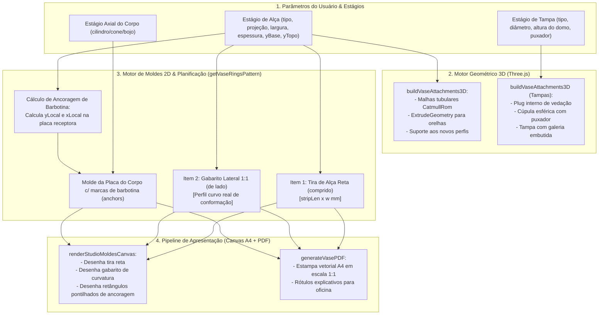

# Plano Técnico de Implementação: Gabaritos de Curvatura de Alças, Marcações de Barbotina e Catálogo Enriquecido

## 1. Arquitetura do Sistema e Fluxo de Dados

---

## 2. Modelo Matemático & Detalhamento das Peças

### A. Gabarito Lateral de Curvatura da Alça ("De Lado, no Formato")
- A alça curvada possui uma curva espinhal $C(t) = (x(t), y(t))$ gerada pelos pontos de controle entre a base $(r_{\text{bot}}, y_{\text{bot}})$ e o topo $(r_{\text{top}}, y_{\text{top}})$ com projeção máxima $P$.
- Para gerar o **gabarito lateral 1:1**, traçamos a silhueta 2D da fita com sua espessura $E$:
  - Curva externa: $C_{\text{ext}}(t) = C(t) + \frac{E}{2} \cdot \vec{n}(t)$
  - Curva interna: $C_{\text{int}}(t) = C(t) - \frac{E}{2} \cdot \vec{n}(t)$
- O gabarito é posicionado como item de molde fechado na folha A4 com legenda:
  `Gabarito Lateral de Curvatura (1:1) — Apoie a tira para moldar`.

### B. Marcações de Barbotina na Placa do Corpo
- Quando uma alça é fixada entre $y_{\text{base}}$ e $y_{\text{topo}}$ da peça:
  - O estágio do corpo correspondente (ex: cilindro ou cone) tem altura $H_{\text{estágio}}$ e início em $y_{\text{início}}$.
  - As posições relativas na placa desdobrada são:
    $$y_1 = y_{\text{base}} - y_{\text{início}}, \quad y_2 = y_{\text{topo}} - y_{\text{início}}$$
  - Largura da marcação: igual à largura da tira $W$ (com margem de 1 mm).
  - Altura da marcação da raiz: espessura da tira chanfrada ($\approx 10\text{ a }15\text{ mm}$).
- No canvas e no PDF, desenha-se um retângulo tracejado com hachura e texto `Encaixe Alça (Barbotina)`.

### C. Catálogo Expandido de Alças e Tampas
- **Alças**:
  1. `fita`: Caneca clássica em "C" ergonômico.
  2. `gota`: Alça puxada orgânica em gota com base mais encorpada.
  3. `arco_ponte`: Alça em arco lateral ou superior de precisão.
  4. `dupla_oposta`: Par de alças simétricas de jarra/sopeira.
  5. `orelha`: Meia-lua sólida de placa chanfrada.
  6. `retangular_vazada`: Alça trapézio vazada para caçarola.
- **Tampas**:
  1. `plana_plug`: Tampa plana com rebaixo interno cilíndrico de encaixe (plugue de vedação) e botão central.
  2. `domo`: Cúpula clássica com puxador esférico torneado.
  3. `galeria_embutida`: Tampa com aba sobreposta e rebaixo para assentamento na galeria interna da boca.
  4. `flange_botao`: Tampa disco plana de perfil fino com botão cilíndrico.

---

## 3. Análise de Segurança STRIDE

| Ameaça | Categoria | Mitigação no CeramiCAD |
| :--- | :--- | :--- |
| **Spoofing** | Identificação | Não aplicável (aplicação client-side sem login/sessão). |
| **Tampering** | Integridade dos dados | Validação rigorosa dos limites numéricos ($y_{\text{base}} < y_{\text{topo}}$, projeção $\in [1, 15]\text{ cm}$). |
| **Repudiation** | Rastreabilidade | Não aplicável. |
| **Information Disclosure** | Vazamento de dados | Toda geração de canvas e PDF ocorre na memória do navegador local sem chamadas de rede externas. |
| **Denial of Service** | Estouro de memória/CPU | Resolução adaptativa da curva do gabarito (24 pontos) evitando travamento do navegador ou do gerador de PDF. |
| **Elevation of Privilege** | Privilégio | Sanitização de strings nos rótulos de molde; nenhum `eval` ou injeção HTML não sanitizada. |

---

## 4. Plano de Tarefas Atômicas

1. **Tarefa 1: Suporte aos Novos Tipos no 3D e UI**
   - Atualizar `renderVaseStagesUI` com opções de alças (`fita`, `gota`, `arco_ponte`, `dupla_oposta`, `orelha`, `retangular_vazada`) e tampas (`plana_plug`, `domo`, `galeria_embutida`, `flange_botao`).
   - Atualizar `buildVaseAttachments3D` para renderizar os novos tipos no Three.js.
2. **Tarefa 2: Geração do Gabarito Lateral 1:1 de Curvatura em `getVaseRingsPattern`**
   - Criar geometria 2D do perfil lateral da alça em escala 1:1.
   - Adicionar o item ao array de moldes para o packing da folha A4.
3. **Tarefa 3: Cálculo e Marcações de Barbotina na Placa do Corpo**
   - Detectar quais alças ancoram em quais placas de corpo.
   - Incluir a coleção `anchors` nos itens de molde de placas receptoras.
4. **Tarefa 4: Renderização Gráfica no Canvas 2D e Exportação PDF**
   - Renderizar no `renderStudioMoldesCanvas` as caixas de ancoragem tracejadas e o gabarito lateral.
   - Integrar ao `generateVasePDF` com escala real 1:1 e instruções de bancada.
5. **Tarefa 5: Verificação e Bateria de Testes**
   - Rodar suíte de testes de 137 testes (`tests/run_tests.js`).
   - Validar que todos os testes passem com 100% de sucesso.
