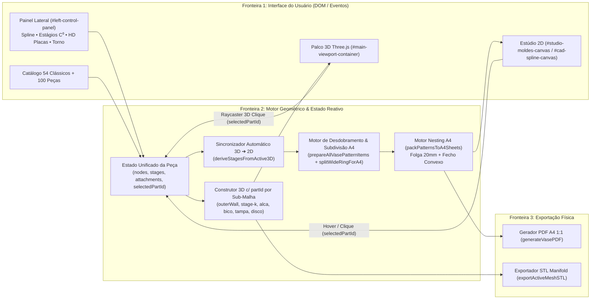

# Plano Técnico de Engenharia: Restauração das Abas 3D/2D, Split-View Interativo 2D↔3D & Conversão A4 1:1

## 1. Tecnologias e Versões Estáveis Confirmadas (Fontes Oficiais)
- **Three.js `r128` (`0.128.0`)**: Motor WebGL (`THREE.BufferGeometry`, `THREE.Raycaster`, `THREE.OrbitControls`, `THREE.STLExporter`). Fonte: [Three.js Docs / CDNJS r128](https://cdnjs.com/libraries/three.js/r128).
- **jsPDF `2.5.1`**: Geração vetorial client-side de documentos PDF A4 em milímetros (`unit: 'mm'`, `format: 'a4'`). Fonte: [jsPDF Official Repository / v2.5.1](https://github.com/parallax/jsPDF/releases/tag/v2.5.1).
- **HTML5 Canvas 2D API**: Renderização cartesiana de perfis e pranchas A4 interativas com hit-testing poligonal (*Point-in-Polygon* / Ray-Casting 2D). Fonte: [MDN CanvasRenderingContext2D](https://developer.mozilla.org/en-US/docs/Web/API/CanvasRenderingContext2D).
- **Tailwind CSS v3 CDN**: Tokens utilitários de layout responsivo e temas claro/escuro. Fonte: [Tailwind CSS Docs](https://tailwindcss.com/docs).

---

## 2. Arquitetura e Fluxo de Dados



---

## 3. Modelo de Dados e Contratos Internos

### 3.1. Identificação Unificada de Partes (`partId`) entre 3D e 2D
Toda sub-malha gerada no `activeMeshGroup` (no Three.js) e todo item de molde gerado para a folha A4 compartilham o mesmo contrato `CeramicPartContract`:

```json
{
  "partId": "stage-1 | disco-0 | alca-0 | bico-0 | tampa-0 | borda-0 | gore-0 | slab-part-0",
  "label": "S2 Cone Inferior (Meia-Faixa 1/2)",
  "type": "cone | cilindro | base | gore_hd | slab_poly",
  "seamLeft": "[A1]",
  "seamRight": "[A2]",
  "bevelDeg": 45.0,
  "dimensionsMm": { "width": 165.4, "height": 48.0, "thickness": 6.0 },
  "rawPoints": [{ "x": 0, "y": 0 }],
  "creases": [{ "p1": { "x": 0, "y": 0 }, "p2": { "x": 10, "y": 10 }, "type": "mountain", "angleDeg": 60 }],
  "holes": [{ "x": 40, "y": 40, "r": 10 }]
}
```

### 3.2. Regras Matemáticas de Conversão 3D ➔ 2D em Folha A4 (`182 × 253 mm` úteis)
1. **Eliminação da Duplicação do Disco de Base**:
   - Em [`prepareAllVasePatternItems`](file:///mnt/c/Users/bruno/Documents/cerâmiKa/index.html#L10862-L11119), os itens de `rings` com `rg.tipo === 'disco'` são ignorados no loop de faixas laterais, pois o disco circular já é gerado com precisão na seção de discos (`disco-0`) com seus furos/crivos/entalhes.
2. **Derivação Automática do Modelo 3D Ativo (`deriveStagesFromActive3D`)**:
   - Se o usuário estiver no modo `spline` (ou tiver selecionado qualquer peça do catálogo), a conversão para moldes 2D amostra os anéis C⁰ diretamente de `vaseSplineNodes` + `currentSplineAttachments` em tempo real quando `vaseDesignMode === 'spline'`, garantindo que o molde 2D na aba 2D e no PDF A4 sempre reflita exatamente o objeto 3D atual na tela.
3. **Subdivisão Inteligente de Faixas Largas para Caber na Folha A4 (`splitRingToFitA4`)**:
   - Uma folha A4 possui área útil de `182 × 253 mm` (diagonal útil máxima de ~`245 mm` considerando a largura da tira).
   - Quando um cilindro ou tronco de cone tem arco desenvolvido $L_{\text{ext}} = 2\pi R_{\max} \cdot f_{\text{retração}}$ que excede as dimensões úteis de uma folha A4 (ou seja, não possui nenhuma orientação válida de $0^\circ$ a $165^\circ$ que caiba em $182 \times 253\text{ mm}$), o motor divide automaticamente o ângulo total de $360^\circ$ em $K = \lceil L_{\text{ext}} / 210 \rceil$ segmentos iguais ($K \in \{2, 3, 4\}$: ex. 2 meias-faixas de $180^\circ$, 3 terços de $120^\circ$ ou 4 quartos de $90^\circ$), adicionando chanfro de costura a $45^\circ$ e etiquetas de união `[S{n}-A ↔ S{n}-B]`.
   - Assim, **nenhum anel desaparece das folhas A4** e o ceramista pode imprimir todas as partes em folhas A4 comuns sem precisar colar dezenas de folhas em mosaico (mantendo opção seletora para quem preferir *Tiling* inteiro).

---

## 4. Design, Layout, Tokens e Estados

### 4.1. Tokens do Design System (Existentes em `index.html`)
- Cores: `--bg-app`, `--bg-panel`, `--border-hairline`, `--accent-clay: #B84A39`, destaque de seleção 2D↔3D: `#F59E0B` (Âmbar 500) / `#D97706` (Âmbar 600).
- Tipografia: `Plus Jakarta Sans` (UI) e `JetBrains Mono` (`font-mono-cad`, cotas e telemetria).

### 4.2. Layout Unificado & Split-View 2D+3D
- **Coluna Esquerda Visível (`#left-control-panel`)**: Fixa em telas desktop (`w-full lg:w-[420px] xl:w-[440px]`, sem `-translate-x-full`) e retrátil no mobile, exibindo todas as funções de **Modelagem de Vasos 3D & Moldes 2D**.
- **Modo 3D**: Palco 3D amplo com Prato de Torno, Dock Flutuante Inferior (Câmera, Acabamentos Cinnabar, Girar Torno, Corte 270°, Aramado) e Barra de Telemetria Inferior (`#app-footer` visível).
- **Modo 2D (Split-View 2D + 3D Interativo)**:
  - Divide a área principal em:
    1. **Painel 2D Interativo (Esquerda/Centro do Palco)**: Alterna entre **Moldes Planificados em Folhas A4 (1:1)** (com seletor de folha `◀ Folha 1/N ▶`, modo de encaixe *Subdivisão A4* vs *Mosaico Tiling*, legenda de corte/vinco/chanfro e clique/hover em cada molde) e **Editor de Perfil CAD Cartesiano** (+ gaveta compacta opcional do catálogo).
    2. **Palco 3D Sincronizado (Direita do Palco)**: O mesmo viewport Three.js renderizado ao vivo ao lado do 2D, permitindo orbitar a peça 3D, clicar diretamente em qualquer parte do objeto 3D (corpo/anel, disco de base, alça, bico, tampa, faceta/gomo) ou clicar/passar o mouse no molde 2D na folha A4 para iluminar a parte correspondente em ambos!
- **Estados da UI**:
  - *Padrão*: Todas as partes renderizadas no acabamento cerâmico escolhido (Terracota, Celadon, Raku, Grés, Sigillata, Porcelana) e desenhadas nas folhas A4.
  - *Hover / Selecionado (`selectedPartId`)*: Parte destacada em **Âmbar Dourado** no 3D e na folha A4 2D, com barra de inspeção superior indicando: `🔍 Parte Selecionada: [Nome] • Dimensões: L × A mm • Chanfro: 45° • Costura: [A1↔A2]`.
  - *Vazio / Erro*: Validação defensiva caso o usuário tente remover todos os estágios (mantém mínimo de 1 estágio).

---

## 5. Estratégia de Testes e Orçamento de Desempenho

| Critério de Aceite | Tipo de Teste | Arquivo / Verificação | Meta / Orçamento |
| :--- | :--- | :--- | :--- |
| **CS1**: Painel esquerdo e funções 3D/2D restauradas | E2E / DOM | `tests/stations/station1.js` | 100% dos controles acessíveis e visíveis |
| **CS2**: 54 Modelos Clássicos com alças, bicos e tampas reais | Integração 3D | `tests/stations/station1.js` | 0 vértices `NaN`, apêndices gerados no `activeMeshGroup` |
| **CS3**: Split-View 2D+3D e seleção visual bidirecional de partes | E2E Interativo | `tests/stations/station1.js` + Browser | Hover/clique 2D e 3D atualiza `selectedPartId` em $< 16\text{ ms}$ (60 FPS) |
| **CS4**: Conversão 3D➔2D em folha A4 sem omissão nem duplicação | Unitário / Contrato | `tests/stations/station1.js` | 0 discos duplicados como faixa; 100% dos anéis presentes nas folhas A4 (`sheets.length >= 1`) |
| **CS5**: Exportação PDF A4 1:1 e STL binário | E2E | `tests/run_tests.js` | Geração de PDF A4 em $< 250\text{ ms}$; zero erros de console |

---

## 6. Pipeline de Validação e Qualidade
1. Checagem de sintaxe JavaScript (`node --check CeramicMeshFactory.js` e extração/validação de script de `index.html`).
2. Execução completa do harness E2E (`node tests/run_tests.js`) cobrindo as estações e os novos testes de Split-View 2D+3D, seleção bidirecional de partes e conversão A4.
3. Inspeção visual real no navegador com capturas de tela comprovando:
   - Painel lateral restaurado com todas as funções.
   - Modelos 3D ricos com alças, bicos, tampas e texturas.
   - Modo 2D em *Split-View* mostrando as folhas A4 interativas ao lado do modelo 3D com uma parte selecionada/destacada em ambos.
4. Atualização do grafo de conhecimento (`graphify update .`).

---

## 7. Decomposição em Tarefas Atômicas

1. **Tarefa 1 — Restaurar Painel Lateral (`#left-control-panel`), Barra de Telemetria (`#app-footer`) e Fidelidade dos Modelos 3D**:
   - Remover o ocultamento `-translate-x-full` de `#left-control-panel` e `hidden` de `#app-footer`.
   - Sincronizar `STUDIO_100_CATALOG` com `CLASSIC_CERAMIC_PROFILES` para que todos os modelos clássicos e utilitários carreguem suas curvas reais e seus apêndices (`alca`, `bico`, `tampa`, `borda`), e corrigir `rebuildVase()` para respeitar o modo ativo do usuário.
2. **Tarefa 2 — Implementar Split-View 2D+3D e Seleção Visual Bidirecional de Partes (`selectedPartId`)**:
   - No Modo 2D (`setStudioAppMode('2d')`), manter o palco 3D visível ao lado da vista 2D (Layout Split-View 55% 2D / 45% 3D com redimensionamento automático do `renderer`).
   - Atribuir `userData.partId` a cada sub-malha gerada em `rebuildVase()` (anéis individuais `stage-k`, `disco-0`, `alca-k`, `bico-k`, `tampa-k`, `borda-k`), `rebuildVaseFromSpline()` (anéis equivalentes e apêndices), `rebuildHDSlabEngine()` e `renderSlabPiece3D()`.
   - Adicionar `THREE.Raycaster` no clique sobre o canvas 3D e hit-testing poligonal no clique/hover sobre `#studio-moldes-canvas` e `#hd-interactive-pattern-canvas`, destacando a parte selecionada tanto no 3D quanto na folha A4 2D com barra de detalhes técnicos da peça.
3. **Tarefa 3 — Corrigir Conversão 3D ➔ 2D em Folha A4 (Sincronização Spline, Fim da Duplicação do Disco e Subdivisão Inteligente A4)**:
   - Criar `deriveActivePatternItemsForA4()` que converte automaticamente o modelo 3D ativo (seja Spline + apêndices, Camadas Conectadas C⁰, Coleção HD ou Placas Utilitárias) em itens 2D prontos para A4.
   - Filtrar `rg.tipo === 'disco'` do loop de faixas cilíndricas em `prepareAllVasePatternItems()`.
   - Implementar `splitRingToFitA4(rg)` para subdividir anéis cujo arco exceda a folha A4 ($182 \times 253\text{ mm}$) em segmentos iguais ($1/2$, $1/3$, $1/4$) com indicação de costura `[A1↔A2]` e chanfro de $45^\circ$, garantindo que todas as partes apareçam nas folhas A4 em `#studio-moldes-canvas`, `#pdf-preview-canvas` e `generateVasePDF()`.
   - Redesenhar `renderStudioMoldesCanvas()` para exibir as folhas A4 paginadas (`Folha 1/N`), régua de $50\text{ mm}$, linhas de corte, linhas de vinco, cotas e hit-boxes interativos para seleção 2D↔3D.
4. **Tarefa 4 — Testes E2E, Verificação Visual no Browser e Atualização do Graphify**:
   - Atualizar e executar `tests/run_tests.js` e validar visualmente no navegador.
