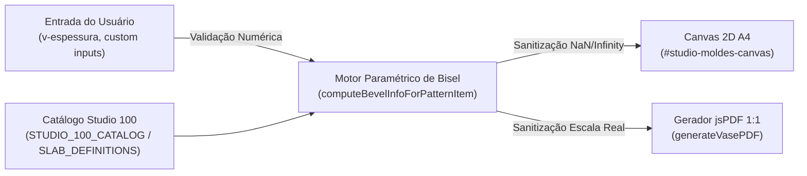

# Threat Model (STRIDE) — Ciclo 05: Cálculo Paramétrico e Estampa de Faixa de Chanfro

## 1. Fronteiras de Confiança e Fluxo de Dados

---

## 2. Análise de Ameaças STRIDE

| Categoria STRIDE | Ameaça Identificada | Risco / Impacto | Mitigação Arquitetural |
| :--- | :--- | :--- | :--- |
| **Spoofing** | N/A (Execução 100% client-side local sem sessão de rede) | Baixo | Não aplicável |
| **Tampering** | Injeção de valores extremos de espessura (ex: $E < 0$, $E = \text{NaN}$, $E = 1000\text{ mm}$) | Médio (Trava do renderizador ou desenho que invade a folha inteira) | Clamping rígido da espessura: $E \in [1.0, 30.0]\text{ mm}$ e limitação de $w \le 0.5 \times \text{largura do molde}$. |
| **Repudiation** | N/A | Baixo | Não aplicável |
| **Information Disclosure** | N/A (Sem dados de usuários, PII ou segredos) | Baixo | Nenhum dado pessoal manipulado |
| **Denial of Service** | Loop ou recursão infinita no cálculo de offset geométrico da faixa | Alto (Crash da aba do navegador) | Vetorização direta das bordas com cálculo fechado em $\mathcal{O}(1)$ por molde, sem loops recursivos |
| **Elevation of Privilege** | XSS em rótulos gerados | Médio (Injeção via innerHTML) | Renderização em Canvas 2D via `ctx.fillText()` e PDF via `pdf.text()` (APIs puras de texto vetorial imunes a XSS) |

---

## 3. Checklist de Segurança & Confiabilidade
- [x] Sanitização estrita contra `NaN` e `Infinity` em todas as operações trigonométricas (`Math.tan`).
- [x] Clamping de $E$ entre $1.0\text{ mm}$ e $30.0\text{ mm}$.
- [x] Limitação de largura da faixa $w \le \min(w, \text{dimensão}/2)$ para evitar que a faixa ocupe todo o molde.
- [x] Zero manipulação perigosa de DOM (`ctx.fillText` puro).
